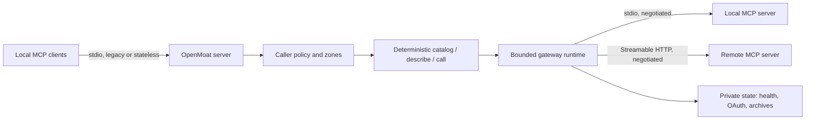

# Architecture

OpenMoat is one TypeScript/Node.js process with four boundaries:

1. `config.ts` validates and normalizes one `Moatfile`. Unknown or retired
   fields fail closed.
2. `server.ts` exposes seven bounded MCP tools over stdio for legacy
   2025-11-25 and stateless 2026-07-28 clients.
3. `gateway.ts` enforces policy before spawn, negotiates either protocol era
   with downstream stdio or Streamable HTTP servers, and owns pools, deadlines,
   breakers, redaction, and cleanup.
4. Private local state stores only derived catalog metadata, aggregate health,
   issuer-bound OAuth state, and caller-bound oversized results.

## Stateless boundary

Modern requests carry protocol, client information, and capabilities per
request. No OpenMoat protocol correctness depends on a session identifier.
Legacy initialization remains supported on outward and downstream stdio for
compatibility. Pooling is only a local startup optimization.

Caller policy is evaluated for each `describe` and `call`. Search results are
filtered through the same caller, trust, and zone decision so denied metadata
does not leak before a call.

## Trust and authorization

Servers begin quarantined unless `trust: trusted` is explicit. Only the
human CLI can change that field. Static `${ENV}` headers are resolved only at
runtime. Interactive authorization-code OAuth with PKCE is available only for
downstream HTTP and only through `moat auth`.

OAuth state filenames are hashes of server names, directories are mode 0700,
files are mode 0600, and credentials are keyed by authorization-server issuer.

## Result boundary

Downstream results are recursively redacted before forwarding. Protocol-hop
metadata is removed. Results are rejected when their depth, entry count, or
archive byte limit is exceeded. Oversized valid results receive a random opaque
handle that can be fetched only under the same caller label and expires by TTL.

## Coverage boundary

Deterministic modules are held to the 80% line/function/branch release gate.
`gateway.ts`, `gateway-runtime.ts`, `mcp-client.ts`, and interactive portions of
`oauth.ts` cross child-process, dual-protocol, browser, and network boundaries;
they are excluded from line-threshold arithmetic and instead must pass the
black-box protocol matrix, process cleanup tests, OAuth state tests, and manual
release checklist. This is an explicit test-method rationale, not an exemption
from verification.
