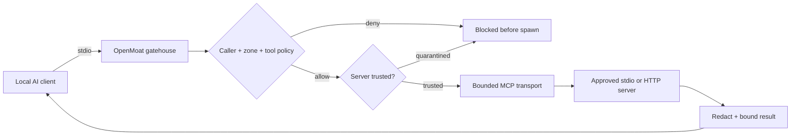

<p align="center">
  
</p>

<p align="center">
  <a href="https://github.com/josephkehan-prog/OpenMoat/actions/workflows/ci.yml"></a>
  <a href="https://nodejs.org/"></a>
  <a href="LICENSE"></a>
  
</p>

<p align="center">
  <strong>One gate. Explicit trust. Local control.</strong>
</p>

<p align="center">
  <a href="#quick-start">Quick start</a> ·
  <a href="#use-case-tour">Use case</a> ·
  <a href="#the-defensive-perimeter">Security model</a> ·
  <a href="#minimal-moatfile">Configuration</a> ·
  <a href="docs/threat-model.md">Threat model</a>
</p>

OpenMoat is the local security gateway for MCP: one TypeScript process lets
multiple local AI clients safely discover and call approved MCP servers through
deny-by-default policy, quarantine, secret redaction, bounded execution, and
deterministic cleanup.

It supports outward stdio clients and downstream stdio or Streamable HTTP
servers across MCP 2025-11-25 and stateless MCP 2026-07-28.

> [!IMPORTANT]
> **v1 release candidate.** The source release is verified on macOS and Linux.
> The npm package has not been published yet.

## The defensive perimeter

OpenMoat v1 does one job: protect and multiplex local MCP access.

| Layer | What it guards |
|---|---|
| **Gatehouse** | Deny-by-default caller, server, tool, and zone policy |
| **Drawbridge** | Human-only quarantine approval and OAuth authorization |
| **Moat** | Secret redaction, clean child environments, and realpath-contained working directories |
| **Portcullis** | Bounded pools, deadlines, circuit breakers, archives, and process cleanup |
| **Watchtower** | Privacy-bounded health and aggregate usage without prompts or results |

Every call crosses the same path:



## Use case tour

Imagine several local AI clients need the same MCP server, but they should not
inherit the same authority.

1. **Declare the server.** It enters the Moatfile as `quarantined`; no client
   can call it yet.
2. **Cut narrow keys.** Give each caller only the `server:tool` patterns and
   capability zone it needs.
3. **Raise the drawbridge once.** A human reviews the command, paths, network
   reach, and capabilities, then runs `trust`.
4. **Route through one gate.** Clients search, inspect, and call tools through
   OpenMoat instead of spawning the downstream server directly.
5. **Contain the return path.** Secrets are redacted, oversized results become
   caller-bound handles, and failures feed bounded health controls.

| Attempt | Outcome |
|---|---|
| An approved caller invokes an allowed tool | Routed to the trusted server |
| An approved caller invokes a denied tool | Rejected before downstream spawn |
| An unknown caller connects | Denied by default |
| A server is still quarantined | Visible to the human, unavailable to agents |
| A result contains configured secrets | Recursively redacted before return |
| A result exceeds the inline limit | Stored privately behind a caller-bound handle |

The pattern is intentionally general: filesystem tools, databases, internal
APIs, browser automation, and other MCP servers all cross the same gate.

It does not include agent-configuration rewriting, harness adapters, profiles,
handoffs, RAG, embeddings, skills, plugins, instincts, federation, evaluation,
backups, or discovery marketplaces. Client configuration is deliberately
documentation-only and non-mutating.

## Quick start

- Node.js 22 or newer
- Git
- A local MCP client that can launch a stdio server

```bash
git clone https://github.com/josephkehan-prog/OpenMoat.git
cd OpenMoat
npm ci
npm run build
node dist/cli.js init ~/.config/openmoat
export OPENMOAT_FILE="$HOME/.config/openmoat/Moatfile"
node dist/cli.js validate
node dist/cli.js doctor
```

Configuration precedence is `--file`, then `OPENMOAT_FILE`, then
`${XDG_CONFIG_HOME:-~/.config}/openmoat/Moatfile`.

## Minimal Moatfile

The starter denies every caller and has no servers. Add a server and a narrow
caller rule:

```yaml
apiVersion: openmoat.dev/v1
kind: Moatfile
paths:
  state: ./state
  secrets: ./secrets.env
gateway:
  callers:
    codex:
      allow: ["files:read_file"]
      deny: ["files:write_file"]
  servers:
    files:
      command: node
      args: ["/absolute/path/to/files-server.mjs"]
      cwdRoots: ["/absolute/path/to/approved/workspaces"]
      capabilities: ["sensitive-read"]
      trust: quarantined
```

Then review and approve it:

```bash
node dist/cli.js validate
node dist/cli.js trust files
node dist/cli.js catalog --refresh
node dist/cli.js doctor
node dist/cli.js serve
```

`trust` is a human-only CLI mutation. No agent-facing MCP tool can approve a
server or initiate OAuth.

## Downstream HTTP and OAuth

Pre-provisioned headers use unresolved placeholders:

```yaml
    remote:
      transport: http
      url: https://mcp.example.com/mcp
      headers:
        Authorization: "Bearer ${REMOTE_MCP_TOKEN}"
      trust: trusted
```

Put `REMOTE_MCP_TOKEN=...` in the ignored, mode-0600 `secrets.env`. For
authorization-code OAuth with PKCE, omit `headers` and run:

```bash
node dist/cli.js auth remote
```

OAuth tokens, registrations, PKCE verifier, and discovery state are stored
privately per server and bound to the discovered issuer. Agent calls never open
a browser; they fail with a direction to run the human command.

## Client snippets

OpenMoat does not edit client configuration. Configure clients manually and set
a stable local policy label:

```json
{
  "mcpServers": {
    "openmoat": {
      "command": "node",
      "args": ["/absolute/path/to/OpenMoat/dist/cli.js", "serve"],
      "env": {
        "OPENMOAT_FILE": "/absolute/path/to/Moatfile",
        "OPENMOAT_CALLER": "codex"
      }
    }
  }
}
```

`OPENMOAT_CALLER` is a trusted local-launcher assertion. Without it, modern
requests use per-request `clientInfo` and legacy requests use initialized
`clientInfo`. These are policy labels, not cryptographic identities; processes
running as the same operating-system user are not isolated from one another.

## Command surface

Human CLI: `init`, `validate`, `serve`, `doctor`, `auth`, `trust`, `catalog`,
`usage`, and `list`.

Agent tools: `tool_search`, `tool_describe`, `tool_call`,
`tool_result_fetch`, `moat_health`, `moat_usage`, and `registry_list`.

## Security boundary

OpenMoat is a policy gateway, not an operating-system sandbox. Trusting a local
MCP executable allows it to act with the current user's privileges. Use a
separate account, container, or sandbox wrapper for untrusted code.

See [SECURITY.md](SECURITY.md) and
[docs/threat-model.md](docs/threat-model.md).

Report vulnerabilities privately as described in
[SECURITY.md](SECURITY.md). Do not open a public issue containing credentials,
tokens, or private configuration.

## Development

```bash
npm test
npm run test:coverage
npm run verify
```

Contributions use signed Conventional Commits and test-driven RED/GREEN
checkpoints. See [CONTRIBUTING.md](CONTRIBUTING.md) and
[CODE_OF_CONDUCT.md](CODE_OF_CONDUCT.md).

## License

[MIT](LICENSE) © 2026 Joseph Han.
